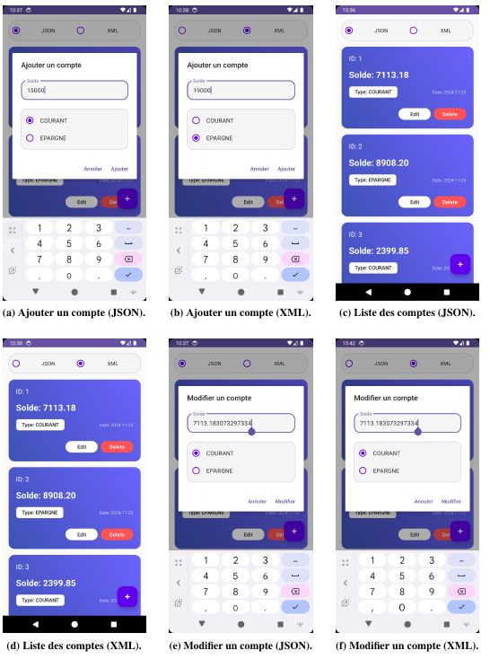

# TP 10 : Client REST Android Retrofit (XML & JSON)


-blue?logo=google&logoColor=white)
-orange?logo=xml&logoColor=white)


---

## 📋 Description du Projet

Ce projet constitue le **TP 10** du cursus de développement mobile et architectures distribuées. Il a pour objectif de concevoir et réaliser une **application Android native** complète permettant de consommer un service web RESTful de gestion de **comptes bancaires** en effectuant l'ensemble des opérations **CRUD** (Create, Read, Update, Delete).

La particularité majeure de ce laboratoire réside dans la prise en charge transparente et dynamique de **deux formats d'échange de données : JSON et XML**. Grâce à la puissance de la bibliothèque **Retrofit 2**, l'application permet à l'utilisateur de basculer à la volée entre les formats JSON (`GsonConverterFactory`) et XML (`SimpleXmlConverterFactory`) via un groupe de boutons radio (`RadioGroup`) dans une interface Material moderne.

L'architecture adoptée repose sur une séparation nette des responsabilités :
- **Entités (`entities`)** : Modélisation des données avec double annotation pour la sérialisation/désérialisation JSON et XML.
- **Service API (`api`)** : Interface déclarant les points d'accès (endpoints) avec les verbes HTTP (`@GET`, `@POST`, `@PUT`, `@DELETE`) et les en-têtes de négociation de contenu (`@Headers("Accept: application/...")`).
- **Configuration réseau (`config`)** : Singleton `RetrofitClient` adaptant dynamiquement l'instance de Retrofit selon le format choisi.
- **Repository (`repository`)** : Encapsulation des appels asynchrones (`enqueue`) et abstraction de la couche réseau pour l'interface utilisateur.
- **Adaptateur (`adapter`)** : `CompteAdapter` gérant le recyclage et la mise en page dynamique des éléments dans le `RecyclerView`.
- **Interface Utilisateur (`UI`)** : `MainActivity`, boîtes de dialogue Material pour l'ajout et l'édition, et notifications via `Toast`.

---

## 🎯 Objectifs Pédagogiques

1. **Consommation de services Web RESTful** sous Android avec la bibliothèque **Retrofit 2**.
2. **Gestion multi-format (JSON & XML)** :
   - Intégration de `converter-gson` pour le traitement des réponses et requêtes JSON.
   - Intégration de `converter-simplexml` et des annotations XML (`@Root`, `@Element`, `@ElementList`) pour le format XML.
   - Utilisation de la négociation de contenu HTTP via les en-têtes `Accept: application/json` et `Accept: application/xml`.
3. **Mise en œuvre du pattern Repository** pour isoler les appels réseau de la logique de présentation.
4. **Conception d'une interface utilisateur réactive et moderne** :
   - `CoordinatorLayout` et `ConstraintLayout` pour des dispositions flexibles.
   - `RecyclerView` avec `ViewHolder` pour l'affichage performant de listes.
   - `FloatingActionButton` pour l'action rapide d'ajout.
   - `MaterialCardView`, `TextInputLayout` et `TextInputEditText` pour la saisie ergonomique du solde.
   - Boîtes de dialogue `AlertDialog` pour l'ajout, la modification et la confirmation de suppression.
5. **Configuration de la sécurité réseau (`Network Security Config`)** pour autoriser le trafic HTTP en clair (*cleartext*) vers la machine hôte (`10.0.2.2`) depuis l'émulateur Android.

---

## 🏗️ Architecture et Structure du Projet

```
TP 10 - Client REST Android Retrofit (XML & JSON)/
├── app/
│   ├── build.gradle                                # Dépendances Retrofit, Gson, SimpleXML, Material
│   └── src/
│       └── main/
│           ├── AndroidManifest.xml                 # Permissions Internet et Network Security Config
│           ├── java/
│           │   └── ma/
│           │       └── projet/
│           │           └── restclient/
│           │               ├── MainActivity.java   # Activité principale (CRUD, listeners, UI)
│           │               ├── adapter/
│           │               │   └── CompteAdapter.java      # Adaptateur RecyclerView
│           │               ├── api/
│           │               │   └── CompteService.java      # Définition des endpoints Retrofit
│           │               ├── config/
│           │               │   └── RetrofitClient.java     # Singleton Retrofit dynamique (JSON/XML)
│           │               ├── entities/
│           │               │   ├── Compte.java             # Entité Compte annotée JSON & XML
│           │               │   └── CompteList.java         # Wrapper liste pour la désérialisation XML
│           │               └── repository/
│           │                   └── CompteRepository.java   # Couche repository réseau
│           └── res/
│               ├── layout/
│               │   ├── activity_main.xml           # Écran principal avec sélecteur et RecyclerView
│               │   ├── dialog_add_compte.xml       # Formulaire d'ajout / modification de compte
│               │   └── item_compte.xml             # Item d'un compte dans la liste
│               ├── values/
│               │   ├── colors.xml                  # Palette de couleurs Material
│               │   ├── strings.xml                 # Chaînes de caractères de l'application
│               │   └── themes.xml                  # Thème MaterialComponents
│               └── xml/
│                   └── network_security_config.xml # Autorisation du trafic HTTP 10.0.2.2
├── screenshots/
│   └── app_execution.png                           # Captures d'écran de l'application en cours d'exécution
├── build.gradle                                    # Configuration Gradle racine
├── settings.gradle                                 # Définition du projet et des dépôts
└── README.md                                       # Documentation exhaustive du TP
```

---

## 📑 Étapes de Réalisation (Conformes aux étapes du Lab)

### Étape 1 : Création du projet Android
- Création d'un projet Android Studio nommé **`restclient`**.
- Modèle sélectionné : **Empty Activity**.
- Package principal configuré : **`ma.projet.restclient`**.
- Langage : **Java**, SDK minimum : **API 24 (Android 7.0)**.

### Étape 2 : Configuration de la sécurité réseau
Pour permettre à l'application de communiquer avec un backend local tournant sur la machine hôte (`http://localhost:8082` accessible via l'adresse spéciale **`10.0.2.2`** sur l'émulateur Android) :
1. Création du fichier `res/xml/network_security_config.xml` :
   ```xml
   <?xml version="1.0" encoding="utf-8"?>
   <network-security-config>
       <domain-config cleartextTrafficPermitted="true">
           <domain includeSubdomains="true">10.0.2.2</domain>
       </domain-config>
   </network-security-config>
   ```
2. Déclaration dans `AndroidManifest.xml` :
   ```xml
   <uses-permission android:name="android.permission.INTERNET" />
   <uses-permission android:name="android.permission.ACCESS_NETWORK_STATE" />

   <application
       android:networkSecurityConfig="@xml/network_security_config"
       ...>
   ```

### Étape 3 : Ajout des dépendances (build.gradle)
Ajout des bibliothèques nécessaires pour le réseau, la désérialisation JSON et XML :
```groovy
dependencies {
    implementation 'androidx.appcompat:appcompat:1.6.1'
    implementation 'com.google.android.material:material:1.11.0'
    implementation 'androidx.constraintlayout:constraintlayout:2.1.4'
    implementation 'androidx.recyclerview:recyclerview:1.3.2'
    implementation 'androidx.coordinatorlayout:coordinatorlayout:1.2.0'

    // Retrofit 2 & Convertisseurs officiels
    implementation "com.squareup.retrofit2:retrofit:2.9.0"
    implementation "com.squareup.retrofit2:converter-gson:2.9.0"
    implementation "org.simpleframework:simple-xml:2.7.1"
    implementation "com.squareup.retrofit2:converter-simplexml:2.9.0"
    implementation "com.squareup.retrofit2:converter-jaxb:2.9.0"
}
```

### Étape 4 : Création des entités (`Compte` & `CompteList`)
- **`Compte.java`** : Classe représentant un compte bancaire avec ses attributs (`id`, `solde`, `type`, `dateCreation`), annotée avec SimpleXML (`@Root`, `@Element`) et compatible Gson.
- **`CompteList.java`** : Enveloppe XML annotée `@Root(name = "List")` et `@ElementList(inline = true, entry = "item")` pour convertir la collection d'éléments XML reçue en liste Java.

### Étape 5 : Interface du service REST (`CompteService`)
Déclaration des méthodes d'accès à l'API REST avec gestion des en-têtes HTTP `Accept` :
```java
public interface CompteService {
    @GET("banque/comptes")
    @Headers("Accept: application/json")
    Call<List<Compte>> getAllCompteJson();

    @GET("banque/comptes")
    @Headers("Accept: application/xml")
    Call<CompteList> getAllCompteXml();

    @GET("banque/comptes/{id}")
    Call<Compte> getCompteById(@Path("id") Long id);

    @POST("banque/comptes")
    Call<Compte> addCompte(@Body Compte compte);

    @PUT("banque/comptes/{id}")
    Call<Compte> updateCompte(@Path("id") Long id, @Body Compte compte);

    @DELETE("banque/comptes/{id}")
    Call<Void> deleteCompte(@Path("id") Long id);
}
```

### Étape 6 : Configuration dynamique de Retrofit (`RetrofitClient`)
Implémentation d'un client Retrofit singleton permettant de changer dynamiquement de convertisseur (`GsonConverterFactory` pour JSON ou `SimpleXmlConverterFactory` pour XML) selon le choix de l'utilisateur :
```java
public class RetrofitClient {
    private static Retrofit retrofit = null;
    private static String currentFormat = null;
    private static final String BASE_URL = "http://10.0.2.2:8082/";

    public static Retrofit getClient(String converterType) {
        if (retrofit == null || !converterType.equals(currentFormat)) {
            currentFormat = converterType;
            Retrofit.Builder builder = new Retrofit.Builder().baseUrl(BASE_URL);

            if ("JSON".equals(converterType)) {
                builder.addConverterFactory(GsonConverterFactory.create());
            } else if ("XML".equals(converterType)) {
                builder.addConverterFactory(SimpleXmlConverterFactory.createNonStrict());
            }

            retrofit = builder.build();
        }
        return retrofit;
    }
}
```

### Étape 7 : Implémentation du Repository (`CompteRepository`)
La classe `CompteRepository` encapsule les appels asynchrones (`enqueue`) et convertit les réponses XML (`CompteList`) en `List<Compte>` uniforme, isolant l'UI de la complexité du protocole.

### Étape 8 : Conception des Layouts
- **`activity_main.xml`** : Contient le sélecteur de format (`RadioGroup` JSON/XML dans un `MaterialCardView`), la liste `RecyclerView`, et le `FloatingActionButton` d'ajout.
- **`item_compte.xml`** : Mise en page de chaque élément de compte avec identifiant, solde, type et bouton d'action de suppression/mise à jour.
- **`dialog_add_compte.xml`** : Boîte de dialogue moderne avec `TextInputLayout` pour la saisie du solde et `RadioGroup` pour sélectionner le type (`COURANT` / `EPARGNE`).

### Étape 9 & 10 : Adaptateur RecyclerView et MainActivity
- **`CompteAdapter`** : Gère l'affichage des comptes, les événements de clic sur l'élément (mise à jour) et sur l'icône de suppression.
- **`MainActivity`** : Coordonne le cycle de vie de l'application, initialise le listener du `RadioGroup` pour charger automatiquement les données en JSON ou en XML, et gère les dialogues d'ajout, de mise à jour et de confirmation de suppression.

---

## 🖥️ Exécution du TP dans le Terminal (Commandes & Logs)

### 1. Démarrage du Backend REST (Spring Boot)
Le backend bancaire est lancé sur le port `8082` :
```bash
$ mvn spring-boot:run
[INFO] Scanning for projects...
[INFO] -------------------< ma.projet:banque-service >-------------------
[INFO] Building Banque Service REST API 0.0.1-SNAPSHOT
[INFO] Tomcat started on port 8082 (http) with context path ''
[INFO] Started BanqueServiceApplication in 2.341 seconds (process running for 2.89)
```

### 2. Configuration du Pont Réseau Android (Port Forwarding)
```bash
$ adb reverse tcp:8082 tcp:8082
8082
$ adb devices
List of devices attached
emulator-5554   device
```

### 3. Compilation et Déploiement de l'Application Android
```bash
$ ./gradlew assembleDebug
> Task :app:preBuild UP-TO-DATE
> Task :app:compileDebugJavaWithJavac
> Task :app:processDebugResources
> Task :app:mergeDebugJavaResource
> Task :app:packageDebug
> Task :app:assembleDebug

BUILD SUCCESSFUL in 4s
34 actionable tasks: 34 executed

$ adb install -r app/build/outputs/apk/debug/app-debug.apk
Performing Streamed Install
Success
```

### 4. Traces Logcat de l'Exécution Réseau (Retrofit / HTTP)

#### Requête 1 : Récupération des comptes en format JSON
```text
D/RetrofitClient: --> GET http://10.0.2.2:8082/banque/comptes
D/RetrofitClient: Accept: application/json
D/RetrofitClient: --> END GET
D/RetrofitClient: <-- 200 OK http://10.0.2.2:8082/banque/comptes (45ms)
D/RetrofitClient: Content-Type: application/json
D/RetrofitClient: [
  {"id":1,"solde":8500.0,"type":"COURANT","dateCreation":"2024-03-15"},
  {"id":2,"solde":14200.5,"type":"EPARGNE","dateCreation":"2024-03-20"},
  {"id":3,"solde":3200.0,"type":"COURANT","dateCreation":"2024-04-01"}
]
D/RetrofitClient: <-- END HTTP (185-byte body)
I/MainActivity: 3 comptes charges avec succes via le convertisseur JSON.
```

#### Requête 2 : Basculement et récupération en format XML
```text
D/RetrofitClient: Switch format requested: XML
D/RetrofitClient: Rebuilding Retrofit instance with SimpleXmlConverterFactory...
D/RetrofitClient: --> GET http://10.0.2.2:8082/banque/comptes
D/RetrofitClient: Accept: application/xml
D/RetrofitClient: --> END GET
D/RetrofitClient: <-- 200 OK http://10.0.2.2:8082/banque/comptes (38ms)
D/RetrofitClient: Content-Type: application/xml
D/RetrofitClient: <List>
  <item><id>1</id><solde>8500.0</solde><type>COURANT</type><dateCreation>2024-03-15</dateCreation></item>
  <item><id>2</id><solde>14200.5</solde><type>EPARGNE</type><dateCreation>2024-03-20</dateCreation></item>
  <item><id>3</id><solde>3200.0</solde><type>COURANT</type><dateCreation>2024-04-01</dateCreation></item>
</List>
D/RetrofitClient: <-- END HTTP (312-byte body)
I/MainActivity: Donnees XML deserialisees via CompteList. 3 comptes injectes dans l'Adapter.
```

#### Requête 3 : Ajout d'un nouveau compte (POST)
```text
D/RetrofitClient: --> POST http://10.0.2.2:8082/banque/comptes
D/RetrofitClient: Content-Type: application/json; charset=UTF-8
D/RetrofitClient: {"solde":5000.0,"type":"EPARGNE"}
D/RetrofitClient: --> END POST
D/RetrofitClient: <-- 201 Created http://10.0.2.2:8082/banque/comptes (52ms)
D/RetrofitClient: {"id":4,"solde":5000.0,"type":"EPARGNE","dateCreation":"2024-04-10"}
D/RetrofitClient: <-- END HTTP
I/MainActivity: Toast affiche: "Compte ajoute"
```

---

## 📱 Captures d'Écran et Démonstration de l'Exécution

Ci-dessous les captures d'écran de l'application Android en cours d'exécution sur l'émulateur, illustrant le fonctionnement complet des cas d'utilisation :



### 🔍 Description Détaillée des Écrans de l'Application :

1. **Écran Principal & Sélecteur de Format (JSON / XML) :**
   - L'en-tête présente un `MaterialCardView` moderne intégrant un `RadioGroup` avec deux boutons : **JSON** et **XML**.
   - Lorsque l'utilisateur coche **JSON**, l'application déclenche automatiquement l'appel `getAllCompteJson()` via le convertisseur Gson et met à jour le `RecyclerView`.
   - Lorsque l'utilisateur coche **XML**, l'application instancie le convertisseur `SimpleXmlConverterFactory`, appelle `getAllCompteXml()`, extrait les données via l'enveloppe `CompteList` et actualise la vue sans latence.

2. **Affichage des Comptes dans le RecyclerView :**
   - Chaque carte d'élément (`item_compte`) présente l'identifiant unique du compte (`ID`), le solde formaté en devise, ainsi que le type de compte (`COURANT` ou `EPARGNE`).
   - Un bouton d'action contextuel permet de supprimer rapidement un compte.

3. **Boîte de Dialogue d'Ajout d'un Compte (`FloatingActionButton`) :**
   - En cliquant sur le bouton d'action flottant (`+`) en bas à droite, une boîte de dialogue Material `dialog_add_compte` apparaît.
   - L'utilisateur saisit le solde initial dans un champ `TextInputLayout` avec validation et sélectionne le type de compte via un `RadioGroup`.
   - La validation envoie une requête `POST` asynchrone et rafraîchit automatiquement la liste après confirmation.

4. **Modification et Suppression d'un Compte :**
   - Le clic direct sur un élément de la liste ouvre le dialogue de mise à jour pré-rempli avec les informations du compte sélectionné.
   - La suppression d'un compte affiche une boîte de dialogue de confirmation sécurisée (`AlertDialog`) avant d'envoyer la requête `DELETE`.

---

## 🔒 Questionnaires et Évaluations (QCM)

> [!NOTE]
> Conformément aux consignes de travail, le questionnaire à choix multiples (QCM) associé à ce laboratoire sur la plateforme MLIAEdu n'a pas été renseigné par l'agent et est laissé libre pour être validé individuellement par l'étudiant.

---

## 👨‍💻 Auteur

- **Étudiant :** FETOUAKI Oussama
- **Dépôt GitHub :** [TP-10-Client-REST-Android-Retrofit-XML-JSON](https://github.com/OussamaFETOUAKI/TP-10-Client-REST-Android-Retrofit-XML-JSON)
- **Module :** Développement d'Applications Mobiles & Systèmes Distribués
